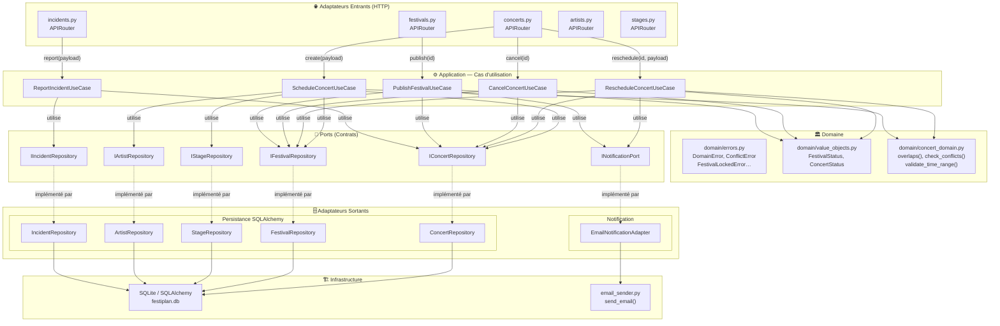

# Diagramme de Composants UML — FestiPlan

Ce diagramme représente l'architecture hexagonale réelle de FestiPlan après refactorisation.

## Vue d'ensemble



---

## Légende des couches

| Couche | Rôle | Dépendances |
|--------|------|-------------|
| **Adaptateurs entrants** | Traduit HTTP → cas d'utilisation | Cas d'utilisation + ports |
| **Cas d'utilisation** | Orchestre les règles métier | Domaine + ports |
| **Domaine** | Logique pure, invariants | Aucune |
| **Ports** | Contrats abstraits | Aucune |
| **Adaptateurs sortants** | Implémentations concrètes | Infrastructure |
| **Infrastructure** | Base de données, email | Externe |

---

## Règle fondamentale

> Le **domaine** et les **cas d'utilisation** ne dépendent jamais des adaptateurs.  
> Toute dépendance est inversée via les ports (Dependency Inversion Principle).

---

## Structure des fichiers

```
app/
├── domain/
│   ├── errors.py           ← Exceptions métier typées
│   ├── value_objects.py    ← FestivalStatus, ConcertStatus (enums)
│   └── concert_domain.py   ← Logique pure (overlaps, conflits, validation)
│
├── ports/
│   ├── repositories.py     ← IConcertRepository, IFestivalRepository…
│   └── notifications.py    ← INotificationPort
│
├── use_cases/
│   ├── schedule_concert.py
│   ├── reschedule_concert.py   ← Défauts 1, 2, 3 corrigés
│   ├── cancel_concert.py
│   ├── publish_festival.py     ← Défaut 3 corrigé
│   └── report_incident.py
│
├── repositories/           ← Adaptateurs SQLAlchemy (implémentent les ports)
│   ├── concert_repository.py
│   ├── festival_repository.py
│   ├── stage_repository.py
│   ├── artist_repository.py
│   └── incident_repository.py
│
├── services/
│   └── notification_service.py ← EmailNotificationAdapter (best-effort)
│
└── api/                    ← Adaptateurs HTTP (contrôleurs FastAPI)
    ├── concerts.py
    ├── festivals.py
    ├── incidents.py
    ├── artists.py
    └── stages.py
```
