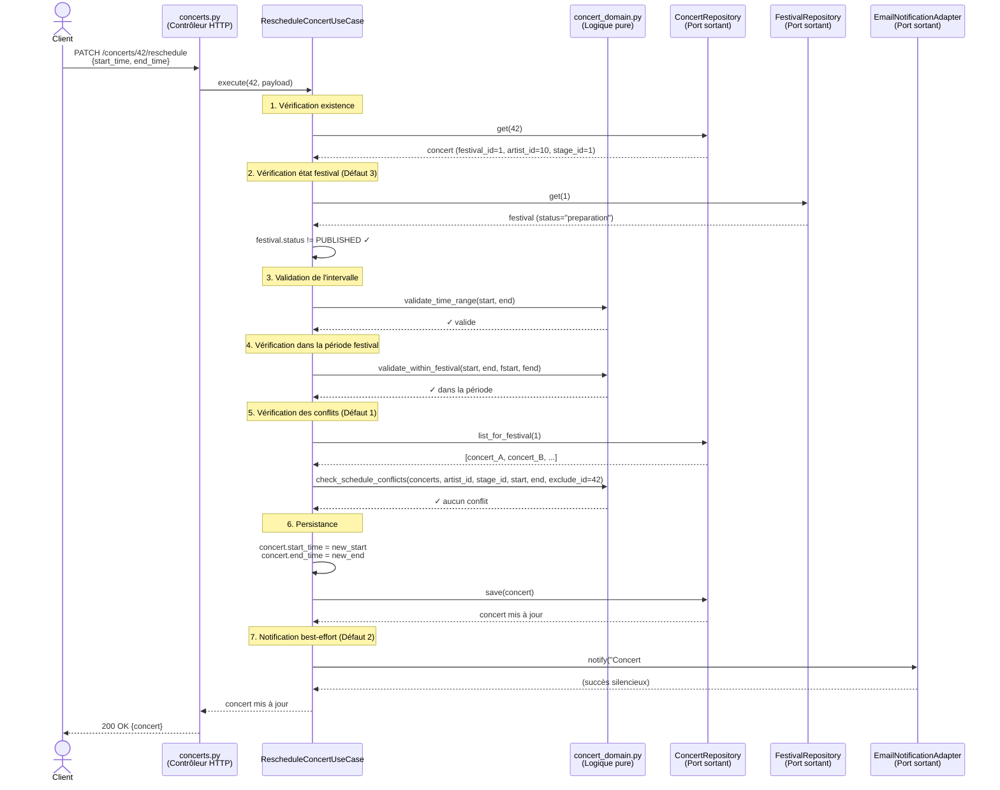
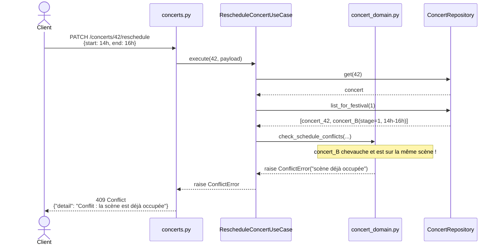
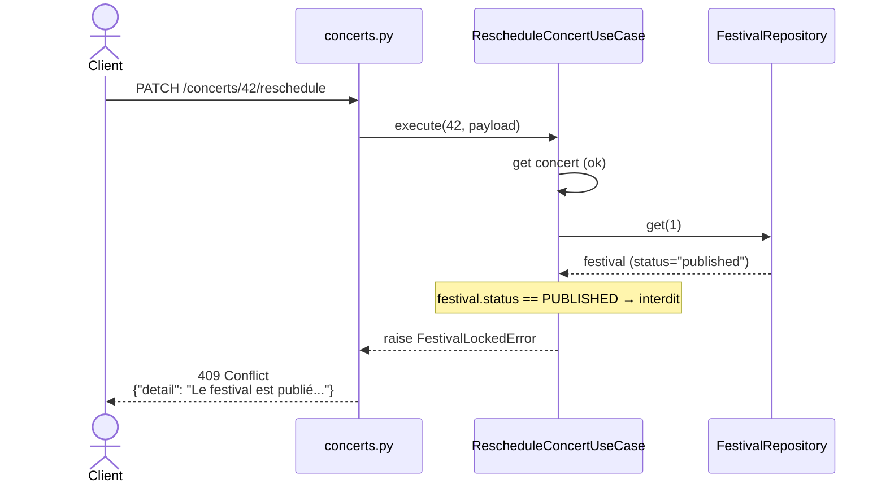
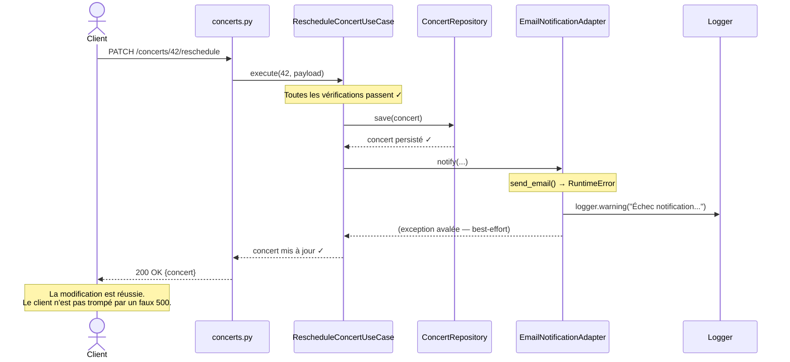

# Diagramme de Séquence UML — Déplacement d'un Concert (RescheduleConcert)

Ce diagramme illustre le cas d'utilisation `RescheduleConcert`, qui implique
la vérification des règles de programmation, la persistance et une notification
best-effort. Il représente la correction des 3 défauts initiaux.

---

## Scénario nominal — Déplacement réussi

---

## Scénario — Conflit de scène (Défaut 1 — refus)

---

## Scénario — Festival publié (Défaut 3 — refus)

---

## Scénario — Panne de notification (Défaut 2 — succès métier maintenu)

